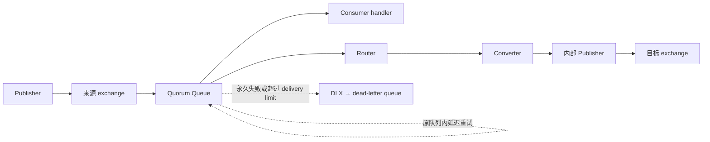

# FclEx.RabbitMQ 设计草案

状态：首版实现及单节点集成验证已落地，本文保留设计依据。更新日期：2026-11-13。具体可用 API 和示例以 README.md 及源代码为准；多节点故障演练仍属于部署验收，不表示已经完成。

## 项目归属与命名

1. 重构实现在独立项目/包 `FclEx.RabbitMQ` 中，目标路径为 `src/FclEx.RabbitMQ/FclEx.RabbitMQ.csproj`，命名空间使用 `FclEx.RabbitMQ`。
2. 配套测试独立放在 `test/FclEx.RabbitMQ.Tests/`，与 `FclEx.Kafka.Tests` 分开。
3. 新项目直接依赖 `RabbitMQ.Client`，按需复用 `FclEx.Logging` 和 Core 的序列化等基础能力；不依赖 `FclEx.Kafka`，不照搬旧 Processor 继承框架。
4. broker 专用类型统一使用 `RabbitMq` 前缀，例如 `RabbitMqPublisher<T>`、`RabbitMqConsumer<T>`、`RabbitMqRouter<TInput, TOutput>`、`RabbitMqQueueOptions`。类型名前缀使用 PascalCase，避免连续大写字母；项目、包、目录和命名空间仍保留 `RabbitMQ`。
5. `ReceivedMessage<T>`、`PublishMessage<T>`、`IMessageConverter<TInput, TOutput>` 等上下文已经明确的类型不机械叠加前缀；其命名空间仍是 `FclEx.RabbitMQ`。
6. 新项目与测试项目已加入 solution。RootNamespace 通过现有 Directory.Build.targets 保持为空；主要代码位于 `FclEx/RabbitMQ/`，原生客户端扩展位于 `RabbitMQ/Client/`。原混合消息包中的旧 RabbitMQ 实现及测试已移除，剩余 Kafka 功能独立为 `FclEx.Kafka`。

## 1. 目标与范围

围绕三个明确的用途提供轻量封装：

| 角色 | 输入与输出 | 自动声明的资源 |
| --- | --- | --- |
| Publisher | 将一个消息发布到指定 exchange | 目标 exchange |
| Consumer | 从指定 queue 接收消息并调用 handler | queue、配置的来源 exchange 与 binding、死信拓扑 |
| Router | 从指定 queue 接收消息，经 Converter 转换后发布到指定 exchange | Consumer 所需拓扑，以及目标 exchange |

Publisher 不知道订阅者有哪些，因此不猜测或创建下游业务 queue。需要提前接收消息的 queue，应先由 Consumer/Router 的创建过程声明；不必开始消费即可完成声明。Publisher 默认拒绝没有任何匹配 queue 的发布。

首版聚焦一个输入转换为一个输出，不引入消息总线、插件式处理管道、跨 broker 事务、RPC、Outbox 或调度服务。暂不延续 `MultipleMessageRouter`；将来确有一对多需求时，再单独定义部分发布成功后的重试语义。

## 2. 总体结构：组合三个角色

对外提供 `RabbitMqPublisher<T>`、`RabbitMqConsumer<T>`、`RabbitMqRouter<TInput, TOutput>` 三个具体类型。类型参数分别绑定发布消息、handler 输入和 Converter 输入/输出，不再保留只有生命周期成员的泛型标记接口。

内部复用拓扑声明、确认发布和消费执行逻辑；Router 组合消费执行器与 Publisher，不继承公开 Consumer 类。删除承担全部职责的 `MessageProcessor<TSettings>` 继承树，不要求用户为了传入 handler 或 Converter 而创建子类。



`RabbitMqClient` 负责创建连接和三个角色，拥有其连接；各角色拥有自己的 channel。连接配置直接复用 `RabbitMQ.Client.ConnectionFactory`，支持已有的 virtual host、TLS、凭据和连接恢复选项，不再通过自定义 `ToString()` 拼接含密码的 URI。

角色配置在创建时校验并复制；调用者后续修改配置对象或 headers，不改变已经创建的实例。DI 是可选的装配方式，不通过 `IServiceProvider.GetRequiredService()` 隐式决定新对象及连接的所有权。

## 3. 建议的 API 形状

以下展示核心调用形状；完整参数及 XML 文档以实现为准：

```csharp
// 连接由 client 拥有；loggerFactory、serializer 可作为可选依赖传入。
Task<RabbitMqClient> ConnectAsync(
    ConnectionFactory factory,
    CancellationToken cancellationToken = default);

// client 上的工厂方法完成拓扑声明，返回可用的角色对象。
Task<RabbitMqPublisher<T>> CreatePublisherAsync<T>(
    RabbitMqPublisherOptions options,
    CancellationToken cancellationToken = default);

Task<RabbitMqConsumer<T>> CreateConsumerAsync<T>(
    RabbitMqConsumerOptions options,
    Func<ReceivedMessage<T>, CancellationToken, Task<MessageHandlingResult>> handler,
    CancellationToken cancellationToken = default);

Task<RabbitMqRouter<TInput, TOutput>> CreateRouterAsync<TInput, TOutput>(
    RabbitMqRouterOptions options,
    IMessageConverter<TInput, TOutput> converter,
    Func<ReceivedMessage<TInput>, TOutput, RabbitMqPublishOptions>?
        outputOptionsSelector = null,
    CancellationToken cancellationToken = default);

// Publisher 的核心方法：一次调用发布一条，并等待发布确认。
Task PublishAsync(PublishMessage<T> message,
    CancellationToken cancellationToken = default);

// Consumer 和 Router 的核心方法：任务代表整个消费运行期。
Task RunAsync(CancellationToken cancellationToken = default);

public interface IMessageConverter<TInput, TOutput>
{
    Task<TOutput> ConvertAsync(
        ReceivedMessage<TInput> input,
        CancellationToken cancellationToken);
}

public enum MessageHandlingResult
{
    Completed = 1,
    Retry = 2,
    DeadLetter = 3,
}
```

1. 三个角色及 client 均支持 `IAsyncDisposable`。不再暴露可重复调用的 `InitializeAsync`。
2. `CreateConsumerAsync`/`CreateRouterAsync` 声明资源，但不自动开始消费；调用 `RunAsync` 才订阅。这样可以先准备下游，再启动上游。
3. 同一对象只允许启动一次 `RunAsync`。需要重启已停止或已失败的角色时重新创建；网络暂时中断由客户端自动恢复处理。
4. Converter 只负责类型转换，不负责序列化、发布和 Ack。它能读取输入元数据，但拿不到 channel 或手动 Ack 接口。
5. Router 的静态 routing key 配在 `RabbitMqRouterOptions.Output`；需要动态 key 或每条输出的延迟时，工厂可额外接受返回 `RabbitMqPublishOptions` 的同步 selector。selector 和 Converter 的失败进入同一错误处理流程。
6. 首版不把 `null` 输出解释为过滤。若序列化器允许，`null` 就是一个消息值；丢弃、过滤或一对多转换应以后用明确的返回类型表达。
7. 默认值 `0` 和未定义的处理结果不能解释为成功；按 handler 契约错误记录并走失败流程，避免遗漏返回值导致误 Ack。

## 4. 配置模型与默认值

配置不再沿用 `ConsumerOptions : PublisherOptions`。共用 exchange、queue 和 binding 定义即可。

| 配置 | 主要内容 | 建议默认值 |
| --- | --- | --- |
| `RabbitMqExchangeOptions` | `Name`、`Type`、声明 arguments | topic、durable、非 auto-delete |
| `RabbitMqQueueOptions` | `Name`、`Retry`、`DeadLetter`、可选容量限制 | 明确名称、Quorum、durable、非 exclusive、非 auto-delete |
| `RabbitMqBindingOptions` | 来源 `Exchange`、`RoutingKey`、binding arguments | 空 routing key 合法，空 binding 集合合法 |
| `RabbitMqPublisherOptions` | `Exchange`、发布确认超时 | 30 秒；confirms 与 mandatory 开启 |
| `RabbitMqConsumerOptions` | `Queue`、`Bindings`、`PrefetchCount`、`MaxConcurrency`、停止超时 | prefetch=1、并发=1、停止超时=30 秒 |
| `RabbitMqRouterOptions` | `Input` 消费配置、`Target`、`Output` 发布配置 | 使用相同消费与确认发布规则 |
| `RabbitMqRetryOptions` | `Enabled`、`MinDelay`、`MaxDelay`、`DeliveryLimit` | 开启、1 秒、30 秒、20 |
| `RabbitMqDeadLetterOptions` | 死信 exchange、queue 名称与 binding key | 自动生成 `<queue>.dlx`、`<queue>.dead`，key 为源 queue 名 |

`PublishMessage<T>` 是不可变消息 envelope，包含 Body、routing key、消息 ID、关联 ID、业务 headers 和本次发布选项。未指定消息 ID 时在 envelope 创建时生成一次，重复提交同一 envelope 不更换 ID。序列化默认复用现有 `IMemoryBytesSerializer` 与 `SerializerPresets.Utf8StringOrJson`，允许注入替代实现，不另建序列化框架。

首版自动声明的业务队列和死信队列统一使用 Quorum Queue。暂不提供 classic/stream/临时队列兼容模式；这些模式确有需求时再扩展。Quorum Queue 不支持服务器生成名称和 exclusive，本设计也不提供空 queue 名或自动删除选项。单节点测试可用，但没有多节点容错能力。[Quorum Queue 限制](https://www.rabbitmq.com/docs/quorum-queues#features-that-are-not-supported)

`Retry.Enabled=false` 表示业务处理失败直接进入死信，不表示开启立即无限重试。死信拓扑默认启用；首版不提供悄悄丢弃失败消息的默认分支。

原生默认 exchange 使用明确的 `Default` 定义表示：引用它而不重复声明，也不对它执行显式 binding；发布时 routing key 使用目标 queue 名。普通 exchange 名不能为空。`amq.*` 等系统 exchange 只引用，不尝试重建为自定义类型。

## 5. 自动创建拓扑的规则

1. 声明是幂等的“确保存在且定义一致”，不是删除重建。队列类型、exchange 类型或 arguments 不一致时，创建角色失败，保留现有数据并报告冲突。
2. Consumer 可以有多个 binding，也可以没有 binding；订阅 queue 本身不强制要求配置来源 exchange。没有 binding 时，仍可通过默认 exchange 按 queue 名投递。
3. Consumer 的创建顺序是：来源 exchange、死信 exchange、死信 queue 与 binding、业务 queue、业务 binding、QoS。最后才允许 `RunAsync` 发起消费。
4. Router 创建时先准备完整输入拓扑和目标 exchange，再允许消费。它不拥有目标 exchange 的所有订阅队列；目标 Consumer/Router 也应先完成创建。
5. 同名资源必须使用同一份定义；同名 queue 的重试和死信规则是队列级契约，不能由不同 Consumer 各设一套。
6. 失败时释放本次创建的本地连接/channel，但不自动删除已经声明的 broker 资源，因为其他实例可能正在使用它们。
7. Dispose 释放本地资源，不删除 exchange、queue、binding，不清空消息。

第一版通过 AMQP 声明 arguments，保证只需要 AMQP 连接即可使用；不为了修改 policy 强制增加 Management HTTP API 和管理员权限。常用配置使用类型化属性，额外 arguments 不得覆盖库负责的保留键。

RabbitMQ 推荐将可运维调整的参数放在 policy 中；客户端 arguments 可能覆盖普通 policy，且变更可能需要重建队列。这里明确接受首版“声明配置即拓扑契约”的取舍，不承诺热更新或管理外部 policy。已有队列依赖 policy 时，应先统一拓扑配置的管理方式，不能让两套配置互相覆盖。[DLX 配置与 policy 优先级](https://www.rabbitmq.com/docs/dlx#how-dead-lettering-is-configured)

## 6. Publisher 的可靠发布契约

1. 默认持久化消息，启用 publisher confirms、确认跟踪和 `mandatory=true`。
2. `PublishAsync` 成功只表示 broker 接受并确认了发布，而且没有返回不可路由错误；不表示业务已经消费完成，也不证明所有预期订阅者的 binding 都配置正确。
3. 没有匹配队列、broker nack、确认超时、连接关闭均通过异常报告，不仅记录日志。
4. 超时、取消或断线发生在发送之后时，结果可能未知。库不自动无界重发；调用方重试应沿用同一消息 ID，并依靠消费方幂等。
5. Publisher 持有长生命周期的发布 channel，内部串行化共享 channel 的操作，避免每条消息创建 channel。吞吐优化以后再引入有界 channel 池，不提前加入复杂调度器。
6. 首版只提供单条核心方法。若增加集合便捷方法，必须说明按顺序逐条发送、并非事务；中途失败时前面已经确认的消息不会回滚。

[Publisher confirms 与 consumer Ack 是独立机制](https://www.rabbitmq.com/docs/confirms)。不能用等待一段时间或关闭 channel 代替发布确认。

## 7. Consumer 与 Router 的确认、重试和失败

| 场景 | Consumer | Router |
| --- | --- | --- |
| 处理成功 | handler 返回 `Completed` 后 Ack | Converter、输出属性生成和目标发布均成功，并收到确认后才 Ack 输入 |
| 临时失败 | `Retry` 或未分类业务异常 | Converter/selector/目标发布发生可重试失败 |
| 永久失败 | `DeadLetter` 或反序列化失败 | 无法反序列化、确定无效的输入或输出 |
| 停止时业务取消 | 不确认未完成消息，结束时交还 broker | 同左；已经发布但未确认输入的消息可能重复转发 |

重试直接使用原 queue 的原生 delayed retry：`BasicRejectAsync(deliveryTag, requeue: true)`。不 Ack 后再重新发布，不使用原 routing key 回推来源 exchange，也不阻塞工作线程等待延迟。永久失败使用 `BasicRejectAsync(..., requeue: false)` 进入 DLX。

Ack/Reject 发送失败是传输故障，不是处理成功；终止该会话的继续处理并进入恢复流程，保留结果未知的诊断信息，让 broker 回收未确认消息，不能捕获后继续假装完成。

重试次数以 broker 的 `x-delivery-count` 和 `delivery-limit` 为准，不再维护独立的 `d-error-times`。`DeliveryLimit` 使用 broker 的原意，包含 broker 认定的失败投递，不命名为严格的“业务 handler 最大调用次数”。

重要区别：从 4.3 起，`basic.reject` 与 `basic.nack` 对失败计数不同。业务失败必须使用前者；不能将后者作为等价替换，否则可能绕过失败次数上限。默认 `x-delayed-retry-type=all`，使失败和非失败返回都获得延迟；线性增长依赖失败计数。[RabbitMQ 4.3 的计数与 delayed retry 说明](https://www.rabbitmq.com/blog/2026/04/23/rabbitmq-4.3-release)

Router 不提供跨“消费输入 + 发布输出”的原子事务。目标发布已确认、输入 Ack 尚未完成时进程退出，会重复转发。建议输出默认保留输入 `MessageId` 作为该一对一转换链路的稳定身份，保留 `CorrelationId`，业务在各自消费边界做幂等；若确实创建新的业务消息身份，应显式生成新 ID 并记录 causation。

## 8. 两种延迟分别设计

### 8.1 版本边界

| 功能 | 最低 broker 版本 | 本设计中的使用方式 |
| --- | --- | --- |
| 普通发布、消费、转换转发 | 本次重构基线为 4.3 | AMQP 0-9-1，沿用 RabbitMQ.Client |
| 消费失败后的原生延迟重试 | 4.3 + Quorum Queue | 队列配置与 reject/requeue |
| 首次发布时指定延迟/投递时刻 | 4.4 + Quorum Queue | 消息 header `x-opt-delivery-time` |

官方旧插件项目已停止维护，并明确指向 4.4 的 Quorum Queue 原生延迟能力；新设计不再创建 `x-delayed-message` exchange，也不再使用 `x-delay`、`x-delayed-type`。[插件项目说明](https://github.com/rabbitmq/rabbitmq-delayed-message-exchange#this-project-is-no-longer-maintained)

本次查看的 `docker-common/rabbitmq` 本地及两份 VPS Compose 文件仍声明 `rabbitmq:4.3-management`。这是仓库配置，不是对当前远端版本的审计；实施首次发布延迟前，需要确认实际集群升级至 4.4，并启用升级所需 feature flags。本次不修改部署。

### 8.2 Publisher/Router 的首次投递延迟

`PublishMessage<T>`/`RabbitMqPublishOptions` 提供互斥的 `TimeSpan? Delay` 与 `DateTimeOffset? DeliverAt`：前者是相对时间，后者是绝对时间。未设置或零延迟表示立即可投递；负延迟和两者同时设置属于参数错误；已经到期的绝对时间按立即投递处理。

每次 `PublishAsync` 开始时将目标时间一次性换算为 UTC Unix 毫秒，写入 `long` 类型的 `x-opt-delivery-time`。时间计算应检查溢出并向上取整到毫秒，避免正延迟被截断为更早的时刻。同一次调用中的发送尝试不重新计算目标时刻；调用者跨调用重试相对 `Delay` 时会重新计时，需要保持原计划时应保存并复用绝对 `DeliverAt`。

该 header 可通过现有 AMQP 0-9-1 客户端发送，不必为此更换 AMQP 1.0 客户端。延迟发生在 Quorum Queue 内：先完成路由和复制，确认的是已经存储，并非“到时间才路由”。[Quorum Queue 的 AMQP 0-9-1 header 格式](https://www.rabbitmq.com/docs/quorum-queues#delayed-messages)、[4.4 的路由时机说明](https://www.rabbitmq.com/blog/2026/10/20/rabbitmq-4.4-release)

因此必须明确以下行为：

1. 发布时就需要目标 queue 和 binding 存在；延迟期间新建的订阅队列不会自动收到这条旧消息。
2. Publisher/Router 使用普通 topic/direct/fanout/headers exchange，无需特殊延迟 exchange 或额外等待队列。
3. 即时消息不应被前面的长延迟消息阻塞；到期仅表示可被消费，不保证准点执行或严格 FIFO。
4. 延迟消息占用队列容量；容量不足、TTL、时钟偏差和 broker 停机仍会影响实际投递。首版不混合提供 TTL 配置，避免把过期时间误当成调度时间。
5. 连接到不支持该能力的 broker 时，在发送延迟消息前明确失败，不能让 broker 忽略 header 而立即投递。连接恢复后重新确认能力；集群全节点升级与 feature flags 仍是部署前提。
6. exchange 类型不能证明下游 queue 类型。普通 AMQP 连接无法枚举并可靠验证所有外部 binding；`mandatory` 也不是这个能力检查。库声明的队列保证为 Quorum，外部绑定必须遵守同一契约，不承诺自动发现任意 classic queue 混入。

### 8.3 Consumer/Router 的延迟重试

将队列重试配置转换为以下参数，不为每个延迟创建 TTL/DLX 重试队列：

| 参数 | 默认草案 |
| --- | --- |
| `x-queue-type` | `quorum` |
| `x-delayed-retry-type` | `all` |
| `x-delayed-retry-min` | `1000` 毫秒 |
| `x-delayed-retry-max` | `30000` 毫秒 |
| `x-delivery-limit` | `20` |

队列原生退避为 `min(MinDelay × delivery-count, MaxDelay)`，是线性退避，不是指数退避。参数使用正整数毫秒，`MaxDelay >= MinDelay`；若希望固定延迟，可以令两者相等。[原生 delayed retry 配置](https://www.rabbitmq.com/blog/2026/04/23/rabbitmq-4.3-release#delayed-retries)

保持消息在原队列内，意味着 A 订阅者重试不会让 B 订阅者的独立队列再收到一次重新广播。

首版不提供 `RetryAfter(TimeSpan)` 这种任意逐消息重试时刻 API：当前 AMQP 0-9-1 的 reject 不能携带新的投递时间。AMQP 1.0 的 modified outcome 才能表达该覆盖；不能把发布用的 header 原地修改后冒充可生效的 reject 参数。这是后续更换协议或新增显式调度能力时再讨论的扩展。

## 9. 死信与元数据边界

每个业务 queue 默认有独立的 direct DLX 和 durable Quorum dead-letter queue，避免多个来源的 binding key 意外混用。死信队列不自动回流、不再递归创建自己的死信拓扑。

源队列同时配置 `x-dead-letter-exchange`、`x-dead-letter-routing-key`、`x-dead-letter-strategy=at-least-once`、`x-overflow=reject-publish`。这组参数须整体配置，不能只设置 DLX 就声称可靠死信。目标不可用时，允许源队列保留待转移消息并产生背压；监控队列容量，不能转而静默丢弃。[可靠死信及限制](https://www.rabbitmq.com/docs/quorum-queues#activating-at-least-once-dead-lettering)、[broker 支持的 queue arguments](https://github.com/rabbitmq/rabbitmq-server/blob/main/deps/rabbit/src/rabbit_quorum_queue.erl)

收到的 `ReceivedMessage<T>` 提供 `Body`、`MessageId`、`CorrelationId`、来源 exchange、routing key、redelivery 标记、broker 投递计数及只读 headers 快照；不暴露可修改的收到属性或 Ack 句柄。删除反射修改 `ReadOnlyBasicProperties` 私有字段的做法。

Router 创建独立的输出属性：保留选定业务 headers 和关联身份；清除输入的 `x-opt-delivery-time`、旧 `x-delay`、`x-death`、broker 投递计数及旧自定义重试计数；按输出序列化器重新生成 content type/encoding。输出延迟来自输出配置，不能让输入队列的重试历史或调度状态污染下一阶段。

保留 header 的规则应为显式业务 header 白名单/selector，排除协议与 transport 保留字段。调用者提供的 headers 不能覆盖库生成的调度字段。反序列化失败时不需要构造一个假的 `T`：记录错误并让 broker 对原始消息执行死信处理。

业务异常详情通过消息 ID 关联结构化日志。AMQP 0-9-1 的 reject 不能向原消息追加异常 headers，不承诺死信中自动带有业务异常对象；持久化错误报告事件属于以后按需增加的能力。

## 10. 生命周期、并发与可观测性

1. client 可以共享一个长连接；每个 Consumer 独立消费 channel，每个 Publisher 独立发布 channel。Router 使用不同的消费和发布 channel，不在消费 channel 上等待输出确认。
2. 同一发布 channel 的并发调用串行化；并行消费的 Ack/Reject 也受控发送，并一律按单条确认。`MaxConcurrency >= 1`，`PrefetchCount >= MaxConcurrency`，默认各为 1；提高并发后不承诺业务完成顺序。
3. .NET 客户端收到的 body 有借用期限：在回调返回前完成反序列化或复制，不把借用内存交给后台任务后立即返回。[.NET 客户端内存与 channel 并发要求](https://www.rabbitmq.com/client-libraries/dotnet-api-guide)
4. 停止时先停止接收新消息，再等待在途处理和发布确认。已经完成的业务仍应使用有效的控制令牌确认；没有完成的不能在 finally 中一律 Ack。
5. 停止超时后关闭 channel，让 broker 回收未确认消息。取消不能强行终止用户业务；handler/Converter 必须响应令牌，业务也必须容忍重复执行。
6. 开启客户端连接与拓扑恢复时，不另外启动第二套重复注册 consumer 的恢复循环。恢复前后的 delivery tag/会话归属必须明确，不在新 channel 上确认旧处理任务的 tag。初次连接失败和拓扑定义错误仍应显式失败。
7. 日志包含角色名、queue/exchange、message ID、routing key、失败计数和处理耗时，不输出密码、连接 URI 或消息正文。错误通知回调不能改变 Ack 结果，回调自身失败不能掩盖原错误。
8. 实现使用现有跨目标兼容能力，覆盖 `netstandard2.0`、`net472` 和现代 .NET；不要为了计时或等待直接引入仅新框架可用的 BCL API。

## 11. 后续实施与验收

按以下顺序落地，而不是一次性搬迁全部旧类型：

1. 拓扑定义、client 所有权与确认 Publisher；验证无 binding、类型冲突、confirm nack/超时、取消和并发调用。
2. Consumer 执行器、显式处理结果、死信和原生重试；验证 reject/nack 计数差别、重试上限、反序列化错误、死信目标不可用及停止时不误 Ack。
3. Router 组合；验证目标声明早于消费、目标发布失败不提前 Ack、发布后崩溃可能重复、输入调度/重试 headers 不向输出泄漏。
4. 4.4 首次投递延迟；验证真实最早到达时间、长延迟不阻塞即时消息、提前确认、重启后保留、晚加入的 binding 不收到旧消息，以及不支持的 broker 明确失败。
5. 回归多实例竞争消费、多队列独立订阅、断线恢复和正常停止；覆盖单节点测试与多节点多数派故障，避免把单节点通过解释为 HA 验证。

延迟用例必须同时验证“到期前没有收到”和“到期后能够收到”，不能只在超时内检查总条数。时间测试允许合理的传输/调度余量，不要求毫秒级准点。

旧 classic queue 无法通过重新声明原地变成 Quorum Queue；迁移时使用新队列名或停机迁移，不能由库自动删除旧队列。升级生产 broker、清空旧插件内消息、切换已有队列及删除旧 API 属于后续迁移工作；本次新项目实现未执行这些操作。
